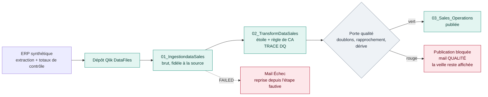
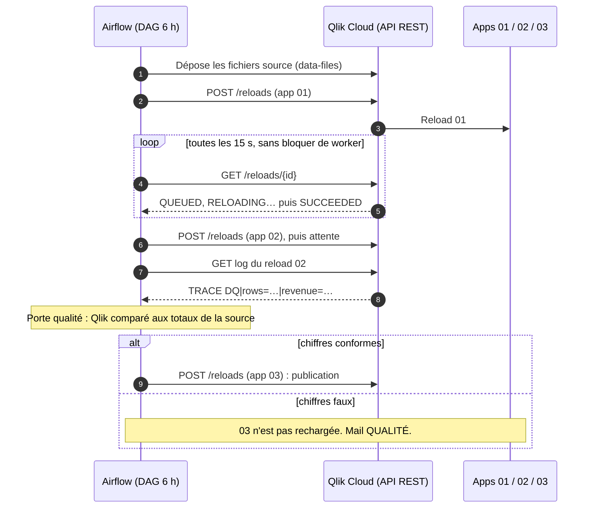
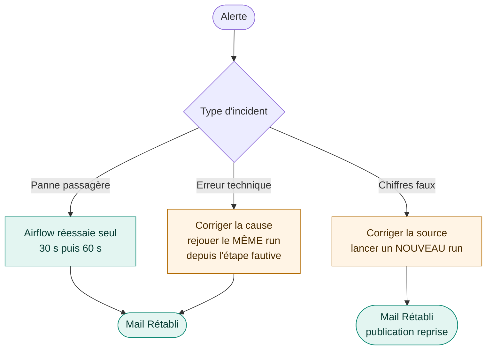
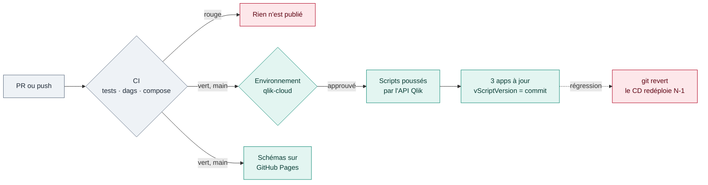

# Qlik × Airflow Lab

**Orchestrer les reloads Qlik Cloud comme le ferait un ordonnanceur d'entreprise, et refuser de
publier des chiffres faux, même quand tout est vert.**

Lab personnel d'un consultant BI senior (Qlik, plus de 15 ans) en route vers le Data Engineering.
Ce n'est pas une mission client : les données sont **100 % synthétiques**.

| Voir | Lien |
|---|---|
| Schéma interactif de la CI/CD | [cicd.html](https://cnanaj-wq.github.io/qlik-airflow-lab/cicd.html) · [source](docs/cicd.html) |
| Schéma interactif de la chaîne (nominal, vert mais faux, reprise) | [workflow.html](https://cnanaj-wq.github.io/qlik-airflow-lab/workflow.html) · [source](docs/workflow.html) |
| Plan de reprise sur incident (décideurs, astreinte) | [docs/PLAN-REPRISE.md](docs/PLAN-REPRISE.md) |

> **Réel / simulé**
> - **Réel** : tenant Qlik Cloud, API REST (reloads, data files, scripts), Airflow 3.4,
>   Postgres, mails d'alerte (boîte de test Mailpit), CI/CD GitHub Actions.
> - **Simulé** : l'ERP source (générateur déterministe), l'incident de doublons, la panne
>   passagère et le renommage de fichier. Ces incidents sont simulés, mais leurs effets dans
>   Qlik sont réels (reload FAILED, CA gonflé). La phase 4 (Qlik Sense on-premise via QRS)
>   utilisera une API **simulée**.

## Le problème

Chez un client Qlik, l'ordonnanceur (Control-M, OpCon, VTOM) sait dire si un reload a **planté**.
Il ne sait pas dire si le chiffre d'affaires publié est **juste**. Un lot livré deux fois donne
un reload `SUCCEEDED`, un tableau de bord frais… et un CA faux le lundi matin en comité.

## La chaîne en une image



En vocabulaire « médaillon » : 01 = bronze, 02 = silver, 03 = gold. La porte qualité se place
**avant** le gold : c'est le principe *write → audit → publish*.

## Qui parle à qui : Airflow pilote, Qlik exécute



## Ce que montre le lab (mesuré le 12 novembre 2026, données synthétiques)

| Scénario | Ce qui se passe | Résultat observé |
|---|---|---|
| **Nominal** | 01 → 02 → porte → 03 | 18 189 lignes de bout en bout, 4 contrôles conformes, environ 1 min |
| **Vert mais faux** | Un lot livré deux fois : 100 lignes en double | Tous les reloads `SUCCEEDED`. CA total **+0,69 %**, CA du jour **+53 %**. Porte rouge, 03 non publiée, mail QUALITÉ |
| **Reprise qualité** | Source corrigée, nouveau run | Porte verte, 03 republiée, incident clos en 5 min 26 s |
| **Erreur technique** | Reload 01 `FAILED` | Arrêt sans nouvel essai, mail Échec, reprise depuis l'étape fautive, mail Rétabli |

Le point clé : **l'écart sur le total détecte le problème ; l'écart sur le jour montre son
ampleur réelle et désigne le lot en cause.**

## Quand quelque chose casse



Détail, rôles et fiches réflexes : [docs/PLAN-REPRISE.md](docs/PLAN-REPRISE.md).

## La CI/CD des scripts Qlik



Explication pour décideurs et réglages GitHub : [docs/CICD.md](docs/CICD.md).

## Avancement

| Phase | Contenu | Statut |
|---|---|---|
| 0 — Socle | Structure, pytest / ruff / mypy, CI | ✅ |
| 1 — Client Python | Apps, reloads, polling, **aucune redirection suivie** (piège du 301), retries 429/5xx | ✅ testé en réel |
| 2 — DAG Airflow | Déclencher → capteur reschedule → porte qualité → publication ; retries ; alertes mail | ✅ testé en réel |
| 3 — Supervision | Tables `reload_runs`, `dq_results`, vue des échecs, panneau Incidents (Pipeline Lens) | ✅ base ; dbt et app de supervision à venir |
| CI/CD | Lint des scripts Qlik, DAG, déploiement vers Qlik Cloud, schémas sur GitHub Pages | ✅ écrit ; à activer sur GitHub |
| 4 — On-premise (simulé) | Mock QRS, même DAG | 🔜 |
| 5 — V2 | QVD temporaires promus si la porte est verte, alerte de fraîcheur, webhooks, OAuth M2M | 🔜 documenté |

## Démarrer

Tout est dans [docs/SCENARIOS.md](docs/SCENARIOS.md), étape par étape : installation, chaîne
nominale, doublons, panne passagère, reprise sur incident, historique des échecs.

| Pour… | Lire |
|---|---|
| Apprendre Airflow avec ce lab (vocabulaire Control-M, bonnes pratiques, exercices) | [docs/GUIDE-AIRFLOW.md](docs/GUIDE-AIRFLOW.md) |
| Comprendre la CI/CD des scripts Qlik | [docs/CICD.md](docs/CICD.md) |
| Savoir quoi faire en cas d'incident | [docs/PLAN-REPRISE.md](docs/PLAN-REPRISE.md) |
| Construire les feuilles de l'app 03 | [qlik/apps/03_Sales_Operations/FEUILLES.md](qlik/apps/03_Sales_Operations/FEUILLES.md) |

## Arborescence

```
src/qlik_lab/          client Qlik Cloud, porte qualité, alertes, supervision, déploiement, CLI
dags/                  qlik_sales_pipeline.py, qlik_supervision_dag.py
qlik/apps.toml         manifeste des 3 apps (l'ordre compte)
qlik/apps/*/script.qvs scripts Qlik versionnés
docker/compose.qlik.yaml   greffe sur un Airflow 3 existant (Mailpit, Pipeline Lens)
docker-compose.yml     Airflow 3 autonome pour un autre poste
docs/                  schémas interactifs (archify), CI/CD, plan de reprise, scénarios
tests/                 unitaires + tests/dags (dans l'image Airflow)
.github/workflows/     ci-cd.yml : tests → dags → compose → deploy, et pages
```

## Sécurité

La clé API Qlik ne figure ni dans Git, ni dans les logs, ni dans la base Airflow : elle est dans
`.env` (exclu de Git), puis dans une connexion Airflow par variable d'environnement, et dans un
secret d'environnement GitHub. Le nom du tenant n'apparaît pas dans le dépôt. Pas de Section
Access dans ce lab.
