# Qlik × Airflow Lab

**Orchestrer les reloads Qlik Cloud comme le ferait un ordonnanceur d'entreprise, et refuser de
publier des chiffres faux, même quand tout est vert.**

| Voir | Lien |
|---|---|
| Schéma interactif de la CI/CD | [cicd.html](https://cnanaj-wq.github.io/qlik-airflow-lab/cicd.html) · [source](docs/cicd.html) |
| Schéma interactif de la chaîne (nominal, vert mais faux, reprise) | [workflow.html](https://cnanaj-wq.github.io/qlik-airflow-lab/workflow.html) · [source](docs/workflow.html) |
| Plan de reprise sur incident (décideurs, astreinte) | [docs/PLAN-REPRISE.md](docs/PLAN-REPRISE.md) |

> **Réel / simulé**
> - **Réel** : tenant Qlik Cloud, API REST (reloads, data files, scripts), Airflow 3.4,
>   Postgres, mails d'alerte (boîte de test Mailpit), CI GitHub Actions, déploiement des scripts
>   par l'API Qlik (lancé depuis le poste).
> - **Simulé** : l'ERP source (générateur déterministe), l'incident de doublons, la panne
>   passagère et le renommage de fichier. Ces incidents sont simulés, mais leurs effets dans
>   Qlik sont réels (reload FAILED, CA gonflé).

## Le problème

Chez un client Qlik, l'ordonnanceur (Control-M, OpCon, VTOM) sait dire si un reload a **planté**.
Il ne sait pas dire si le chiffre d'affaires publié est **juste**. Un lot livré deux fois donne
un reload `SUCCEEDED`, un tableau de bord frais… et un CA faux le lundi matin en CODIR.

## La chaîne en une image

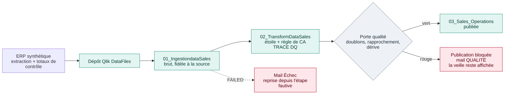

En vocabulaire « médaillon » : 01 = bronze, 02 = silver, 03 = gold. La porte qualité se place
**avant** le gold : c'est le principe *write → audit → publish*.

## Qui parle à qui : Airflow pilote, Qlik exécute

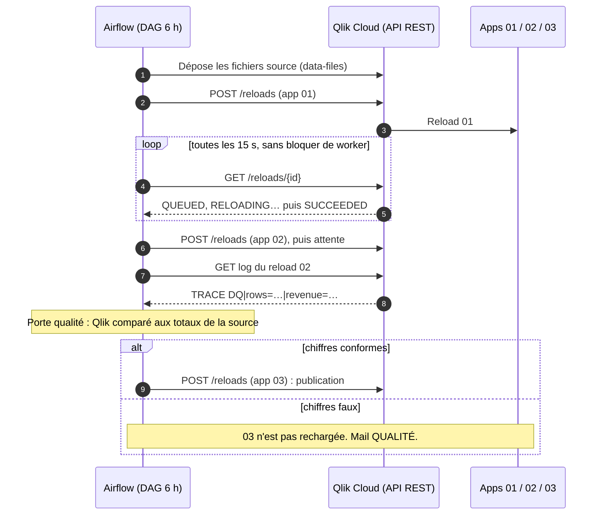

## Ce que montre le lab (mesuré le 12 novembre 2026, données synthétiques)

| Scénario | Ce qui se passe | Résultat observé |
|---|---|---|
| **Nominal** | 01 → 02 → porte → 03 | 18 189 lignes de bout en bout, 4 contrôles conformes, environ 1 min |
| **Vert mais faux** | Un lot livré deux fois : 100 lignes en double | Tous les reloads `SUCCEEDED`. CA total **+0,69 %**, CA du jour **+53 %**. Porte rouge, 03 non publiée, mail QUALITÉ |
| **Reprise qualité** | Source corrigée, nouveau run | Porte verte, 03 republiée, incident clos en 5 min 26 s |
| **Erreur technique** | Reload 01 `FAILED` | Arrêt sans nouvel essai, mail Échec, reprise depuis l'étape fautive, mail Rétabli |
| **Panne passagère** | Dépôt vers Qlik en échec deux fois (simulé) | 2 nouveaux essais automatiques, rétabli en 2 min 42 s sans intervention, mails « nouvel essai » puis « Rétabli » |

Le point clé : **l'écart sur le total détecte le problème ; l'écart sur le jour montre son
ampleur réelle et désigne le lot en cause.**

## En images

Captures du lab en fonctionnement (12 novembre 2026, données synthétiques, adresses masquées).

**Run nominal dans Pipeline Lens** : 18 189 lignes lues, 18 189 chargées, 4 contrôles conformes.

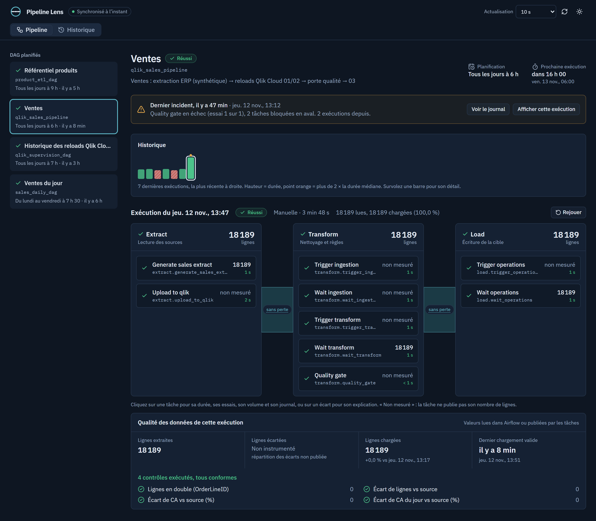

**Vert mais faux** : le lot en double passe l'extraction (18 289 lignes), la porte qualité est
rouge, l'étape Load n'est pas exécutée. L'app 03 garde les chiffres justes de la veille.

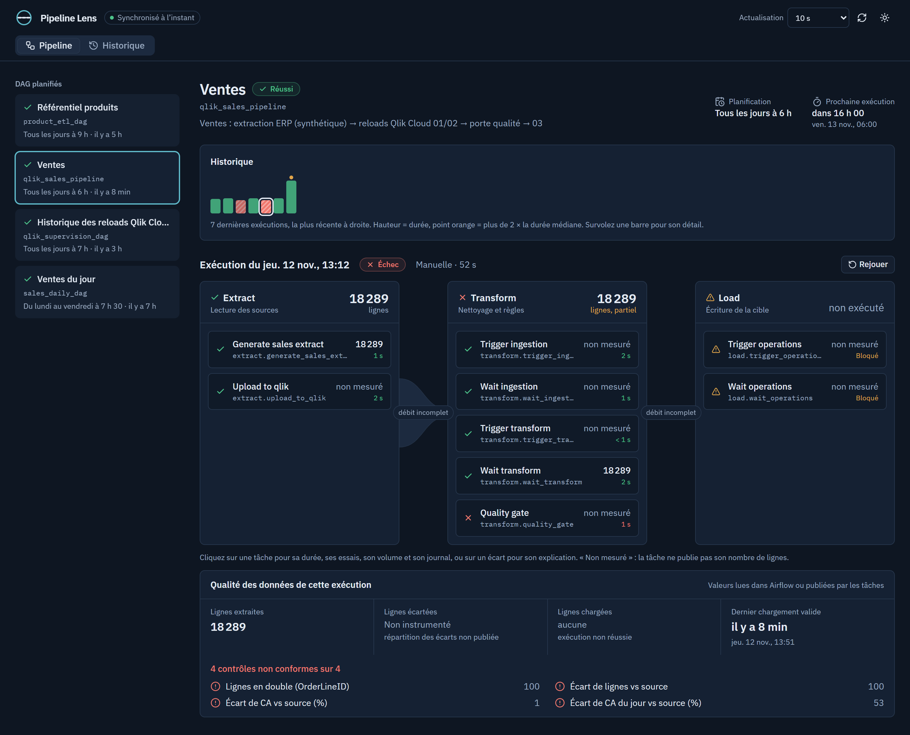

**Le mail QUALITÉ** reçu par l'astreinte, avec les quatre contrôles et l'écart sur le jour (+53 %).

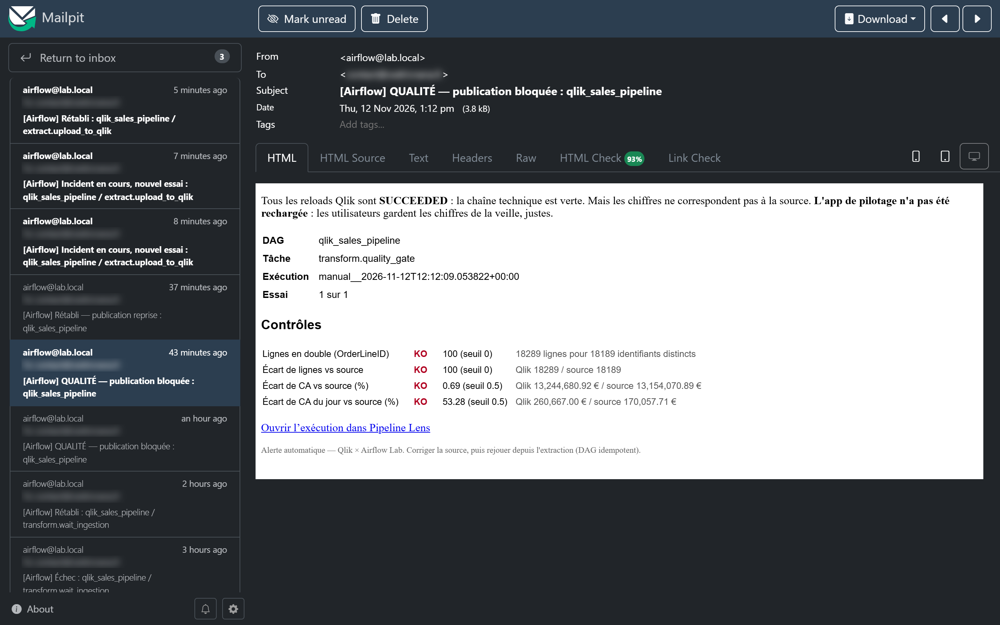

**Historique des incidents** : chaque incident est ouvert, puis clos, avec sa durée et sa façon
de reprendre (nouvel essai automatique ou rejeu).

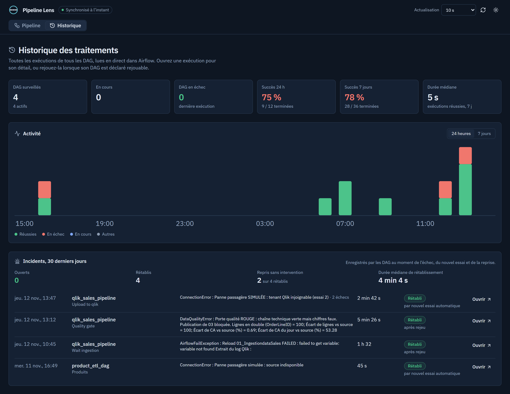

<details>
<summary>Autres captures : boîte d'alertes, mail de nouvel essai, mail de rétablissement</summary>

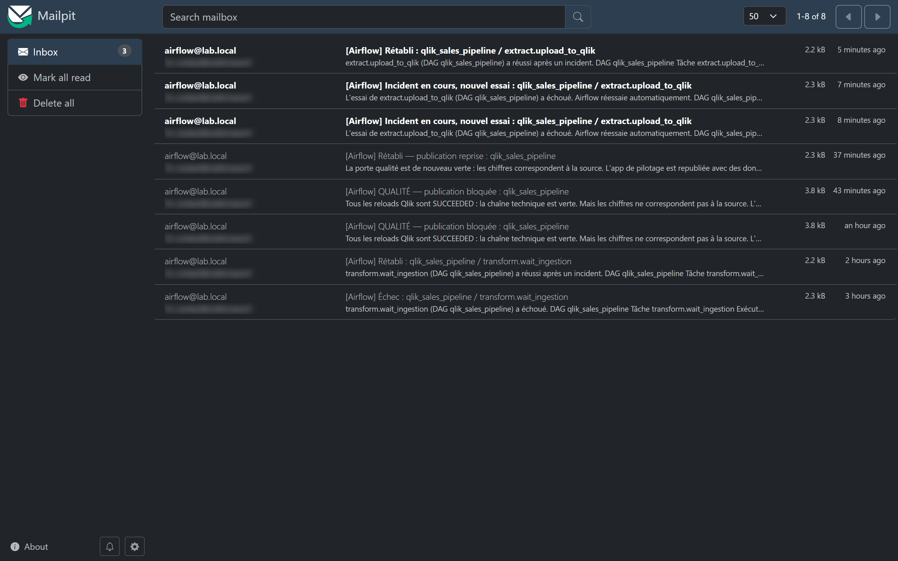
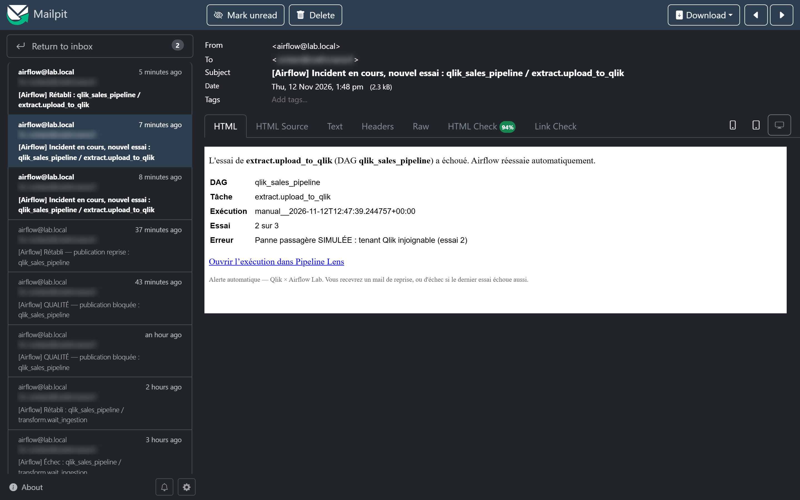
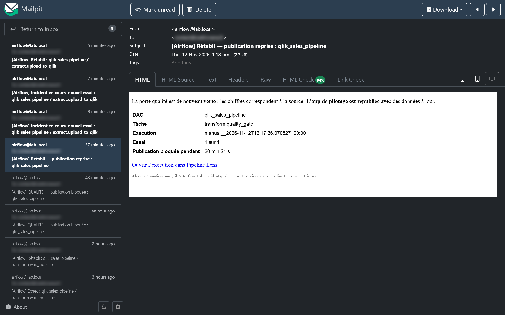

</details>

## Quand quelque chose casse

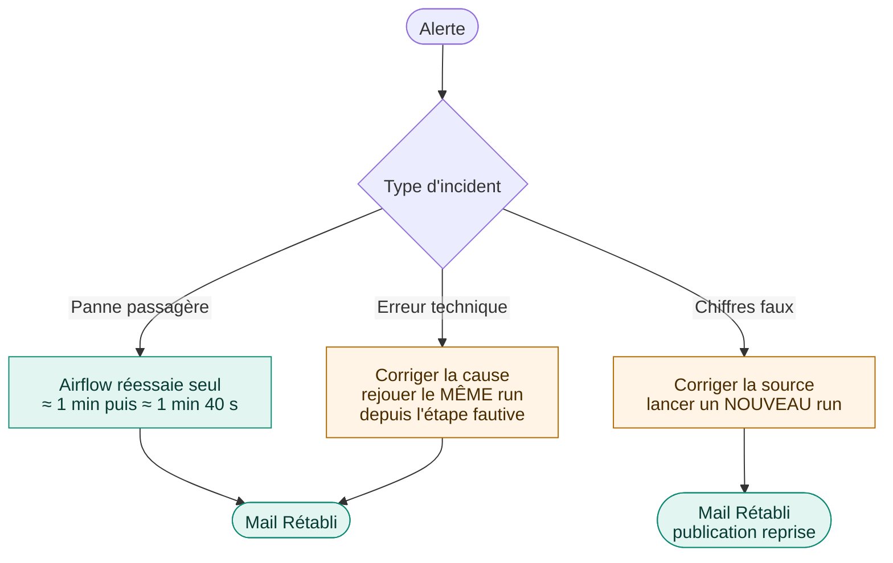

Détail, rôles et fiches réflexes : [docs/PLAN-REPRISE.md](docs/PLAN-REPRISE.md).

## La CI/CD des scripts Qlik

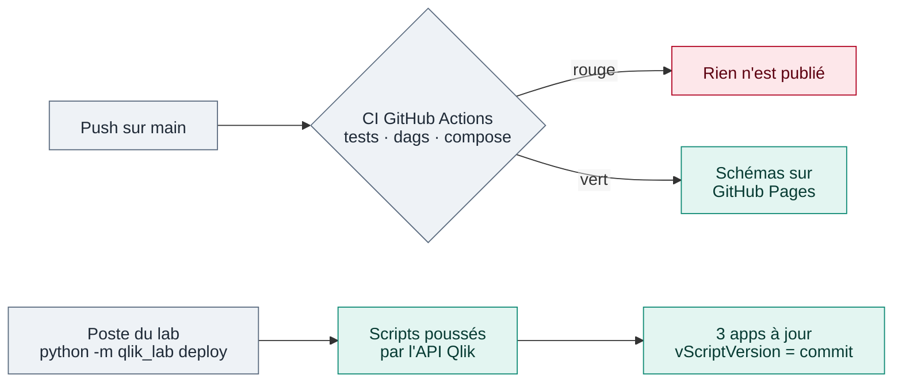

Détail : [docs/CICD.md](docs/CICD.md).

**État réel.** La CI tourne à chaque push sur `main` et publie les schémas sur GitHub Pages. Le
déploiement des scripts vers Qlik Cloud a été exécuté depuis le poste du lab. Le job `deploy` du
workflow existe, mais il n'a encore jamais poussé de script depuis GitHub : l'environnement
`qlik-cloud` n'a pas de secrets.

Chaque script déployé porte en tête le commit dont il vient, injecté par
[`deploy.py`](src/qlik_lab/deploy.py) : `SET vScriptVersion = '<commit>';`. Ce numéro se retrouve
dans l'éditeur de script, dans le log de chaque reload et dans l'app 03.

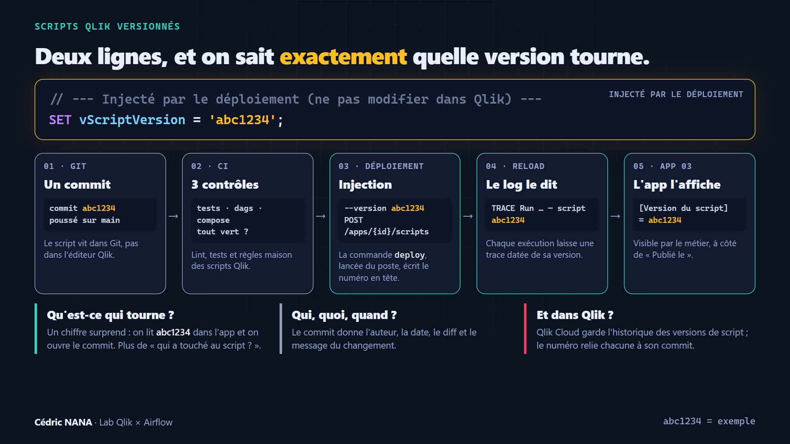

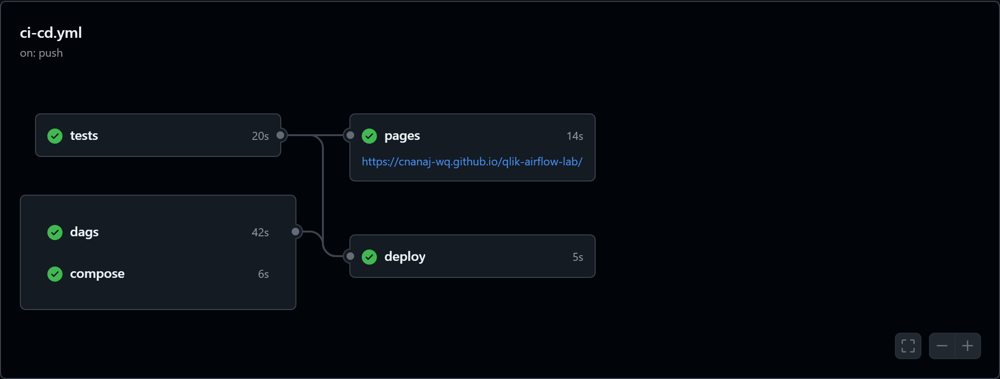

## Exploitation : DataOps, observabilité, FinOps

### DataOps : la donnée traitée comme du code

| Pratique | Dans le lab |
|---|---|
| Versionner | Scripts Qlik, DAG et règles qualité dans Git ; scripts poussés dans Qlik par la commande `deploy`, pas modifiés dans l'éditeur |
| Tester avant de publier | Règles maison des scripts Qlik en CI ; porte qualité (*write → audit → publish*) avant l'app 03 |
| Tracer | `vScriptVersion` dans chaque script, `run_id` dans chaque log de reload |
| Reprendre proprement | Nouvel essai automatique pour une panne passagère ; rejeu depuis l'étape fautive pour une erreur technique ; nouveau run pour des chiffres faux |
| Rejouer sous contrôle | Pipeline Lens : simulation obligatoire avant tout rejeu, journal d'audit, compte dédié `lens_ops` |

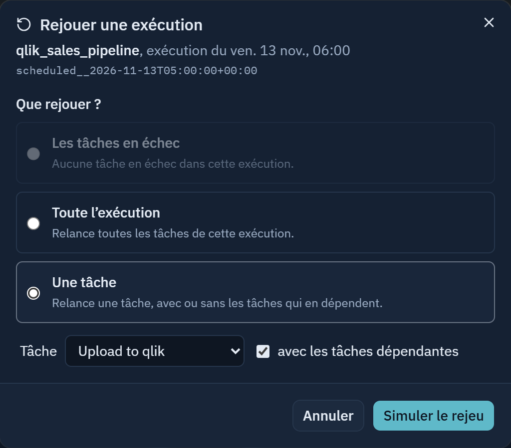

### Observabilité : trois niveaux, trois publics

| Niveau | Outil | Pour qui | Ce qu'on y voit |
|---|---|---|---|
| Santé technique | Grafana (métriques Airflow via StatsD et Prometheus, installés avec l'Airflow du poste, hors de ce dépôt) | Exploitation | Planificateur actif, tâches réussies et en échec, durées des DAG et des tâches |
| Suivi métier | Pipeline Lens (interface installée avec l'Airflow du poste, hors de ce dépôt) | Responsable BI, astreinte | Extract → Transform → Load, volumes, porte qualité, incidents, rejeu |
| Historique | Postgres de supervision : `reload_runs`, `dq_results`, vue `v_reload_failures` | Analyse | Chaque reload (statut, durée, lignes, erreur) et chaque contrôle qualité |

Le DAG `qlik_supervision_dag` rattrape aussi chaque jour les reloads lancés hors Airflow (depuis le
hub, par exemple).

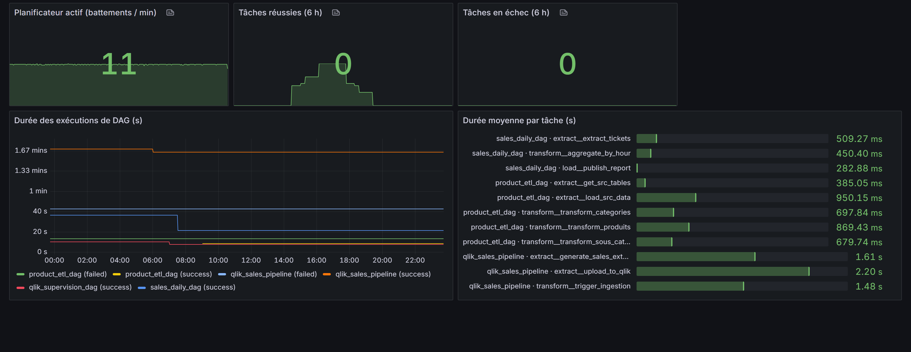

**Ce que les mesures montrent** (12 et 13 novembre 2026, données synthétiques) :

- une exécution complète dure environ **1 min 40 s** (Grafana), alors que les trois reloads Qlik ne
  calculent qu'environ **7 s** au total (2,5 s, 2,8 s et 1,6 s en moyenne, `reload_runs`). Le reste
  est de l'orchestration, surtout l'attente : les capteurs interrogent Qlik toutes les 15 s ;
- cette attente ne coûte rien côté Airflow : en mode `reschedule`, un capteur rend sa place entre
  deux interrogations ;
- sur 8 exécutions : 23 reloads, 1 `FAILED` (arrêt sans nouvel essai) et 2 exécutions bloquées par
  la porte qualité, donc 2 reloads de l'app publiée évités.

### Le temps passé dans la file

Une tâche verte peut se dégrader sans que son statut ne le montre. Avant de s'exécuter, elle attend
qu'un worker la prenne. Airflow enregistre ce temps d'attente (`start_date - queued_dttm` en base,
métrique `queued_duration` vers Prometheus), séparément du temps d'exécution.

| DAG `qlik_sales_pipeline`, 8 exécutions | Attente médiane | Attente max | Exécution médiane |
|---|---|---|---|
| Toutes tâches (exécuteur local) | 0,18 à 0,32 s | 0,71 s | 0,7 à 2,2 s |

Sur ces 8 exécutions, l'attente ne dérive pas. Une hausse isolée s'explique souvent par deux runs
simultanés ; une hausse répétée se lit dans les journaux du scheduler et des workers.

```sql
-- Attente et exécution par tâche, base de métadonnées d'Airflow
SELECT task_id,
       percentile_cont(0.5) WITHIN GROUP (ORDER BY EXTRACT(EPOCH FROM start_date - queued_dttm)) AS attente_med_s,
       max(EXTRACT(EPOCH FROM start_date - queued_dttm))                                         AS attente_max_s,
       percentile_cont(0.5) WITHIN GROUP (ORDER BY EXTRACT(EPOCH FROM end_date - start_date))   AS execution_med_s
FROM task_instance
WHERE dag_id = 'qlik_sales_pipeline' AND queued_dttm IS NOT NULL AND end_date IS NOT NULL
GROUP BY task_id;
```

### FinOps : ce qui évite de consommer pour rien

Le lab ne mesure pas de coût en euros. Ce qui est en place :

- **ne pas recharger pour rien** : porte rouge = pas de reload de l'app publiée ; erreur de script =
  aucun nouvel essai ; seules les pannes passagères sont réessayées, deux fois au plus ;
- **ne pas payer l'attente** : capteurs en mode `reschedule`, aucun worker immobilisé pendant que Qlik
  calcule ;
- **CI courte** : environ une minute de runner, les trois contrôles tournant en parallèle.

## Ce qui est en place

| Brique | Contenu | État |
|---|---|---|
| Socle | Structure, pytest / ruff / mypy, 55 tests | ✅ |
| Client Python | Apps, reloads, polling, **aucune redirection suivie** (piège du 301), retries 429/5xx | ✅ testé sur le tenant |
| DAG Airflow | Déclencher → capteur reschedule → porte qualité → publication ; retries ; alertes mail | ✅ testé sur le tenant |
| Supervision | Tables `reload_runs`, `dq_results`, vue des échecs, panneau Incidents (Pipeline Lens), Grafana | ✅ |
| CI | Lint et tests, règles des scripts Qlik, DAG dans l'image Airflow 3.4, compose, schémas sur GitHub Pages | ✅ à chaque push sur `main` |
| Déploiement des scripts | `python -m qlik_lab deploy` : apps retrouvées par nom, script poussé avec `vScriptVersion` | ✅ lancé depuis le poste ; jamais depuis GitHub (pas de secrets) |

## Démarrer

Tout est dans [docs/SCENARIOS.md](docs/SCENARIOS.md), étape par étape : installation, chaîne
nominale, doublons, panne passagère, reprise sur incident, historique des échecs.

| Pour… | Lire |
|---|---|
| Apprendre Airflow avec ce lab (vocabulaire Control-M, bonnes pratiques, exercices) | [docs/GUIDE-AIRFLOW.md](docs/GUIDE-AIRFLOW.md) |
| Comprendre la CI/CD des scripts Qlik | [docs/CICD.md](docs/CICD.md) |
| Savoir quoi faire en cas d'incident | [docs/PLAN-REPRISE.md](docs/PLAN-REPRISE.md) |
| Construire les feuilles de l'app 03 | [qlik/apps/03_Sales_Operations/FEUILLES.md](qlik/apps/03_Sales_Operations/FEUILLES.md) |

## Arborescence

```
src/qlik_lab/          client Qlik Cloud, porte qualité, alertes, supervision, déploiement, CLI
dags/                  qlik_sales_pipeline.py, qlik_supervision_dag.py
qlik/apps.toml         manifeste des 3 apps (l'ordre compte)
qlik/apps/*/script.qvs scripts Qlik versionnés
docker/compose.qlik.yaml   greffe sur un Airflow 3 existant (Mailpit, Pipeline Lens)
docker-compose.yml     Airflow 3 autonome pour un autre poste
docs/                  schémas interactifs (archify), CI/CD, plan de reprise, scénarios
tests/                 unitaires + tests/dags (dans l'image Airflow)
.github/workflows/     ci-cd.yml : tests → dags → compose → deploy, et pages
```
