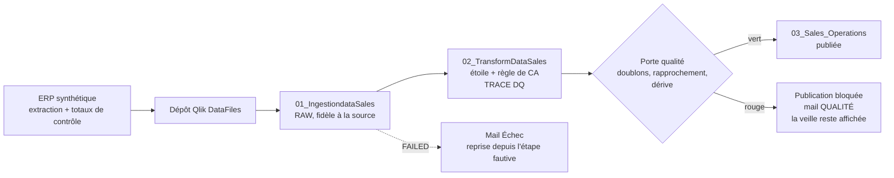

# Qlik × Airflow Lab

**Orchestrer les reloads Qlik Cloud comme le ferait un ordonnanceur d'entreprise, et refuser de
publier des chiffres faux, même quand tout est vert.**

Lab personnel d'un consultant BI senior (Qlik, plus de 15 ans) en route vers le Data Engineering.
Ce n'est pas une mission client : les données sont **100 % synthétiques**.

> **Réel / simulé**
> - **Réel** : tenant Qlik Cloud, API REST (reloads, data files, scripts), Airflow 3.4,
>   Postgres, mails d'alerte (boîte de test Mailpit), CI/CD GitHub Actions.
> - **Simulé** : l'ERP source (générateur déterministe), l'incident de doublons, la panne
>   passagère et le renommage de fichier. Ces trois incidents sont simulés, mais leurs effets
>   dans Qlik sont réels (reload FAILED, CA gonflé). La phase 4 (Qlik Sense on-premise via QRS)
>   utilisera une API **simulée**.

## Le problème

Chez un client Qlik, l'ordonnanceur (Control-M, OpCon, VTOM) sait dire si un reload a **planté**.
Il ne sait pas dire si le chiffre d'affaires publié est **juste**. Un lot livré deux fois donne
un reload `SUCCEEDED`, un tableau de bord frais… et un CA faux le lundi matin en comité.

## La chaîne



| Phase | Contenu | Statut |
|---|---|---|
| 0 — Socle | Structure, pytest / ruff / mypy, CI | ✅ |
| 1 — Client Python | Apps, reloads, polling, **aucune redirection suivie** (piège du 301), retries 429/5xx | ✅ (tests mockés) — essai réel à faire |
| 2 — DAG Airflow | Déclencher → capteur reschedule → porte qualité → publication ; retries ; alertes mail | ✅ (DAG validés dans l'image 3.4) — essai réel à faire |
| 3 — Supervision | Tables `reload_runs`, `dq_results`, vue des échecs, DAG de collecte quotidienne | ✅ base ; dbt et app de supervision à venir |
| CI/CD | Lint des scripts Qlik, DAG, déploiement des scripts vers Qlik Cloud | ✅ |
| 4 — On-premise (simulé) | Mock QRS, même DAG | 🔜 |
| 5 — V2 | Webhooks, OAuth M2M, « Pourquoi pas Qlik Automate seul ? » | 🔜 documenté |

## Démarrer

Tout est dans [docs/SCENARIOS.md](docs/SCENARIOS.md), étape par étape : installation, chaîne
nominale, doublons, panne passagère, reprise sur incident, historique des échecs.

| Pour… | Lire |
|---|---|
| Voir le workflow interactif (4 vues guidées : CI/CD, nominal, vert mais faux, reprise) | [docs/workflow.html](docs/workflow.html) |
| Apprendre Airflow avec ce lab (vocabulaire Control-M, bonnes pratiques, exercices) | [docs/GUIDE-AIRFLOW.md](docs/GUIDE-AIRFLOW.md) |
| Comprendre la CI/CD des scripts Qlik | [docs/CICD.md](docs/CICD.md) |
| Construire les feuilles de l'app 03 | [qlik/apps/03_Sales_Operations/FEUILLES.md](qlik/apps/03_Sales_Operations/FEUILLES.md) |

## Arborescence

```
src/qlik_lab/          client Qlik Cloud, porte qualité, alertes, supervision, déploiement, CLI
dags/                  qlik_sales_pipeline.py, qlik_supervision_dag.py
qlik/apps.toml         manifeste des 3 apps (l'ordre compte)
qlik/apps/*/script.qvs scripts Qlik versionnés
docker/compose.qlik.yaml   greffe sur un Airflow 3 existant (Mailpit, Pipeline Lens)
docker-compose.yml     Airflow 3 autonome pour un autre poste
tests/                 unitaires + tests/dags (dans l'image Airflow)
.github/workflows/     ci-cd.yml : tests → dags → compose → deploy
```

## Sécurité

La clé API Qlik ne figure ni dans Git, ni dans les logs, ni dans la base Airflow : elle est dans
`.env` (exclu de Git), puis dans une connexion Airflow par variable d'environnement, et dans un
secret d'environnement GitHub. Le nom du tenant n'apparaît pas dans le dépôt. Pas de Section
Access dans ce lab.
