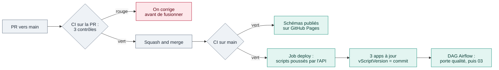

# CI/CD — scripts Qlik « as code »

Schéma interactif : [docs/cicd.html](cicd.html), publié sur GitHub Pages par ce même workflow.
Même logique que [mon premier CI/CD](https://cnanaj-wq.github.io/mon-premier-ci-cd/cicd.html) :
**on vérifie, puis on publie**.

## État réel

| Élément | État |
|---|---|
| CI (`tests`, `dags`, `compose`) | Tourne sur chaque PR vers `main` et chaque push sur `main`, verte |
| Publication des schémas (`pages`) | Tourne après `tests` sur `main`, schémas en ligne sur GitHub Pages |
| Job `deploy` | A poussé les scripts des 3 apps depuis GitHub (lancement *Run workflow*, 10 s) |
| Secrets | `QLIK_TENANT_URL` et `QLIK_API_KEY` dans l'environnement `qlik-cloud`, lus par le seul job `deploy` |
| Règles sur `main` et `features` | Suppression et push forcé interdits, historique linéaire (fusion en *Squash and merge*). Ni approbation ni CI verte exigées par GitHub pour fusionner |

## Le parcours d'une modification, tel qu'il tourne

Bleu-gris : contrôles. Vert : publication. Rose : arrêt.

### Parcours exécuté le 14/11/2026

| Étape | Résultat mesuré |
|---|---|
| PR n° 6 vers `main` | CI verte en 41 s ; `deploy` et `pages` ignorés (une PR n'a pas les secrets) |
| *Squash and merge* | CI verte sur `main` en 47 s, schémas publiés |
| *Run workflow* sur `main` | `tests` 15 s, `dags` 42 s, `compose` 3 s, `pages` 14 s, `deploy` 10 s |
| Résumé du job `deploy` | `01_IngestiondataSales`, `02_TransformDataSales`, `03_Sales_Operations` (existantes) → script `782b273` |
| DAG `qlik_sales_pipeline` (run `cd-782b273-142136`) | Reloads 01 et 02 réussis ; porte qualité verte (écart de CA vs source 0 %, dérive 0 %) ; reload 03 réussi, 17 959 lignes |
| Log du reload 03 | `SET vScriptVersion = '782b273'` et `Run cd-782b273-142136 — script 782b273` |

Le déploiement ne recharge rien : c'est le DAG qui recharge, et 03 ne l'est que si la porte
qualité est verte.

## 01 / CI — vérifier

`.github/workflows/ci-cd.yml`, à chaque push sur `main` :

| Job | Ce qu'il vérifie | Pourquoi |
|---|---|---|
| `tests` | `ruff`, `mypy`, `pytest` (55 tests : client Qlik mocké, porte qualité, alertes, déploiement) | Le code Python est juste |
| `tests` | `tests/test_qlik_scripts.py` | Les **règles maison des scripts Qlik** : pas de Section Access, chemins via `vLib`, `ErrorMode=1`, marqueur DQ présent, blocs `IF` fermés, pas d'`Exit Script` oublié |
| `dags` | Chargement des DAG dans `apache/airflow:3.4.0` | Même version qu'en exécution |
| `compose` | `docker compose config` | Pas de YAML cassé |

Il n'existe pas de linter officiel pour le script Qlik. Ces tests encodent des erreurs vues en
mission.

Durées mesurées sur un run : `tests` 20 s, `dags` 42 s, `compose` 6 s, `pages` 14 s.

## 02 / Déploiement des scripts

La commande `python -m qlik_lab deploy` ([`deploy.py`](../src/qlik_lab/deploy.py)) :

1. retrouve chaque app **par son nom** (`qlik/apps.toml`) et la crée si elle manque ;
2. pousse le script par l'API `apps/{id}/scripts`, en ajoutant en tête
   `SET vScriptVersion = '<commit>';` : l'app affiche le commit dont elle provient ;
3. avec `--dry-run`, affiche seulement le plan ; avec `--reload`, recharge 01 → 02 → 03.

Le job `deploy` du workflow appelle la même commande, après `tests`, `dags` et `compose`, un
déploiement à la fois (`concurrency`), avec les secrets de l'environnement `qlik-cloud`. Il tourne
sur un lancement *Run workflow* (c'est ainsi qu'il a été exécuté) ou sur un push dans `main` qui
modifie `qlik/`. La même commande se lance aussi depuis le poste.

**Job `pages`** : après `tests`, publie les schémas interactifs (`docs/*.html`) sur GitHub Pages.
Seuls les fichiers HTML partent.

## Échecs

| Situation | Ce qui se passe |
|---|---|
| Un contrôle CI est rouge | `deploy` et `pages` ne démarrent pas |
| Script déployé défectueux | Les reloads échouent ou la porte qualité bloque 03 ; on corrige le script dans Git et on redéploie. Qlik Cloud garde aussi l'historique des versions de script |

Le plan complet (incidents de production, rôles, fiches réflexes) : [PLAN-REPRISE.md](PLAN-REPRISE.md).

## Références

- **Qlik** propose l'intégration Git native des apps, `qlik-cli` et l'API `apps/{id}/scripts`.
  Ce lab utilise l'API directement.
- **Astronomer (Airflow)** recommande de tester les DAG dans l'image d'exécution et de ne faire
  aucun appel externe au parsing : ce sont les jobs `dags` et `compose`, et le test
  `test_parsing_is_fast`.
- Le principe « write → audit → publish » (écrire, contrôler, puis publier) inspire la porte
  qualité.
