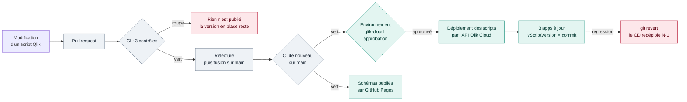

# CI/CD — scripts Qlik « as code »

Schéma interactif : [docs/cicd.html](cicd.html), publié sur GitHub Pages par ce même workflow.
Même logique que [mon premier CI/CD](https://cnanaj-wq.github.io/mon-premier-ci-cd/cicd.html) :
**on vérifie, puis on publie**. Ici, publier veut dire pousser des scripts dans Qlik Cloud.

## En bref, pour un décideur

| Question | Réponse |
|---|---|
| **Quel problème cela règle ?** | Sans CI/CD, un script Qlik est modifié directement dans l'app, en production, sans trace ni relecture. Une erreur se découvre le lendemain matin, par le métier. |
| **Que change la CI/CD ?** | Chaque modification passe par Git, est **testée automatiquement**, puis **déployée par une machine**, jamais à la main. |
| **Qui peut mettre en production ?** | Personne directement. Une modification passe par une PR relue ; le déploiement peut exiger une **approbation** dans GitHub. |
| **Et si une version pose problème ?** | On revient à la précédente par `git revert` : le CD la redéploie. Qlik garde aussi l'historique de chaque script. |
| **Comment savoir ce qui tourne en production ?** | Chaque app affiche le commit dont elle provient (`vScriptVersion`). |
| **Quels secrets circulent ?** | La clé API Qlik, uniquement dans un environnement GitHub protégé. Une PR n'y a jamais accès. |

## Le parcours d'une modification

Bleu-gris : contrôles (CI). Vert : publication (CD). Rose : arrêt ou retour arrière.

## 01 / CI — vérifier avant de publier

`.github/workflows/ci-cd.yml`, à chaque PR et à chaque push sur `main` :

| Job | Ce qu'il vérifie | Pourquoi |
|---|---|---|
| `tests` | `ruff`, `mypy`, `pytest` (client Qlik mocké, porte qualité, alertes, incidents) | Le code Python est juste |
| `tests` | `tests/test_qlik_scripts.py` | Les **règles maison des scripts Qlik** : pas de Section Access, chemins via `vLib`, `ErrorMode=1`, marqueur DQ présent, blocs `IF` fermés, pas d'`Exit Script` oublié |
| `dags` | Chargement des DAG dans `apache/airflow:3.4.0` | Même version qu'en exécution |
| `compose` | `docker compose config` | Pas de YAML cassé |

Il n'existe pas de linter officiel pour le script Qlik. Ces tests encodent des erreurs vues en
mission, et chaque nouvelle erreur rencontrée devient une règle.

## 02 / CD — publier seulement après les tests

**Job `deploy`** : `needs: [tests, dags, compose]` et réservé aux pushs sur `main`. Il ne fait
rien si `qlik/` n'a pas changé.

1. retrouve chaque app **par son nom** et la crée si elle manque ;
2. pousse le script en ajoutant en tête `SET vScriptVersion = '<commit>';` : Qlik garde
   l'historique des versions, et l'app affiche le commit dont elle provient ;
3. en lancement manuel, `reload: true` recharge 01 → 02 → 03 (test de fumée), et `dry_run: true`
   affiche seulement le plan.

**Job `pages`** : après `tests`, publie les schémas interactifs (`docs/*.html`) sur GitHub Pages.
Seuls les fichiers HTML partent : le code et les notes restent dans le dépôt.

## Échecs, protection et reprise

| Situation | Ce qui se passe | Reprise |
|---|---|---|
| Un contrôle CI est rouge | `deploy` et `pages` ne démarrent pas | Corriger, pousser de nouveau |
| PR ouverte | Tests seulement, aucun secret, aucun déploiement | — |
| Deux pushs rapprochés | `concurrency: qlik-cloud-deploy` : un déploiement à la fois, jamais interrompu | Automatique |
| Secret absent ou clé expirée | Le job `deploy` échoue avec un message explicite | Mettre à jour le secret `QLIK_API_KEY` |
| Script déployé mais défectueux | Les reloads échouent ou la porte qualité bloque 03 | `git revert` du commit, push : le CD redéploie N-1 |

Le plan complet (incidents de production, rôles, fiches réflexes) : [PLAN-REPRISE.md](PLAN-REPRISE.md).

## À configurer une fois sur GitHub (par vous)

1. **Settings → Environments → New environment** : `qlik-cloud`. Option : *Required reviewers*
   (vous-même).
2. Dans cet environnement, **Secrets** : `QLIK_TENANT_URL` et `QLIK_API_KEY`.
   **Variables** (option) : `QLIK_SPACE_ID`, `QLIK_APP_PREFIX`.
3. **Settings → Pages → Build and deployment → Source** : `GitHub Actions`.
4. **Settings → Branches → Add rule** sur `main` : PR obligatoire, et vérifications `tests`,
   `dags` et `compose` requises.

## Ce que font les éditeurs (et pourquoi ce lab s'en approche)

- **Qlik** propose l'intégration Git native des apps, `qlik-cli` et l'API `apps/{id}/scripts` pour
  versionner et déployer. Ce lab utilise l'API directement, pour montrer le mécanisme sans outil
  supplémentaire.
- **Astronomer (Airflow)** recommande de tester les DAG dans l'image d'exécution, de ne faire
  aucun appel externe au parsing et de déployer le code des DAG séparément de l'infrastructure.
  Ce sont les jobs `dags` et `compose`.
- **dbt Labs** a popularisé le principe « write → audit → publish » : on écrit, on contrôle, puis
  on publie. La porte qualité en est la version Qlik.
