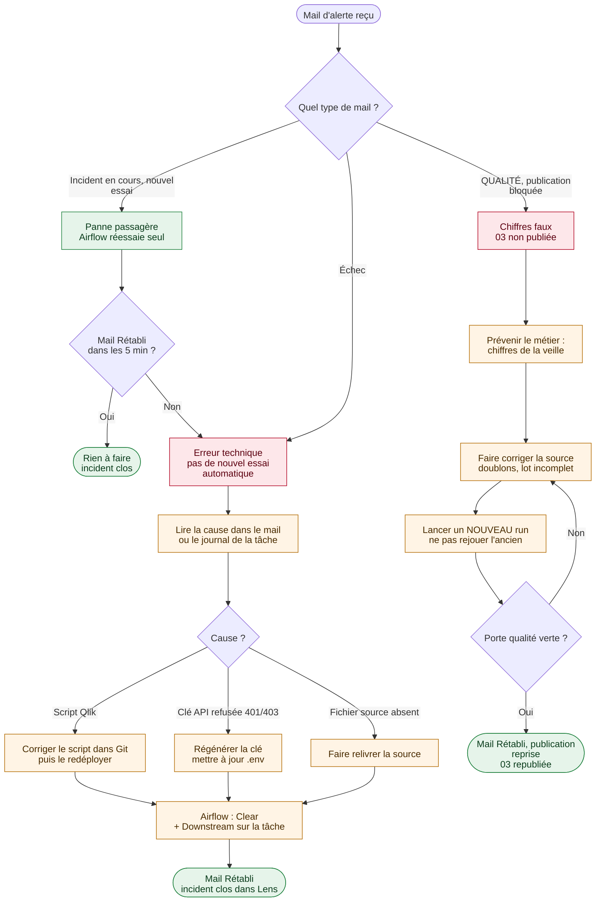

# Plan de reprise sur incident — chaîne Ventes Qlik

> **Pour qui ?** Un décideur, un manager ou une astreinte qui doit savoir, en quelques minutes,
> ce qui peut casser, qui est prévenu, ce qui se répare tout seul et ce qui demande une action.
>
> **Périmètre.** Lab personnel, données synthétiques. Les durées citées ont été **mesurées
> dans le lab** le 12 novembre 2026 : ce ne sont ni des engagements de service ni des résultats
> client. En entreprise, les délais cibles se fixent avec le métier.

## En 30 secondes

Chaque matin à 6 h, Airflow alimente trois apps Qlik Cloud : **01** (données brutes),
**02** (calculs) et **03** (l'app que le métier ouvre). Le plan repose sur trois engagements :

1. **Un chiffre non contrôlé n'est jamais publié.** Avant de recharger 03, Airflow compare
   les chiffres de Qlik aux totaux déclarés par la source. S'ils divergent, 03 garde les
   chiffres justes de la veille.
2. **Chaque incident prévient quelqu'un, puis annonce sa fin.** Un mail part à l'échec, un
   autre au rétablissement. Le panneau Incidents de Pipeline Lens garde l'historique.
3. **Tout est rejouable sans risque.** Relancer une étape ne crée ni doublon ni effet de bord
   (traitements idempotents). La reprise se fait depuis l'étape fautive, pas depuis zéro.

## Le logigramme de décision



Vert : automatique. Orange : action humaine. Rouge : la chaîne s'arrête volontairement.

## Les trois familles d'incident

| | Panne passagère | Erreur technique | Chiffres faux |
|---|---|---|---|
| **Exemple** | Tenant Qlik injoignable 1 min, réseau, limite d'API (429) | Script Qlik en erreur, fichier source absent, clé API expirée | Lot livré deux fois : CA gonflé |
| **Ce que voit Qlik** | Rien, ou un appel refusé | Reload `FAILED` | Reload `SUCCEEDED` : tout est vert |
| **Qui détecte** | Airflow | Airflow (statut du reload + log Qlik) | **Porte qualité** d'Airflow (Qlik ne peut pas le voir) |
| **Réaction automatique** | 2 nouveaux essais espacés (environ 1 min, puis 1 min 40 s) | Arrêt immédiat, sans nouvel essai | Arrêt avant 03 : publication bloquée |
| **Mail** | « Incident en cours, nouvel essai », puis « Rétabli » | « Échec », puis « Rétabli » | « QUALITÉ — publication bloquée », puis « Rétabli — publication reprise » |
| **Impact métier** | Aucun, ou quelques minutes de retard | 03 n'est pas rafraîchie : chiffres de la veille | 03 n'est pas rafraîchie : chiffres de la veille, **justes** |
| **Action humaine** | Aucune | Corriger la cause, puis rejouer **le même run** depuis l'étape fautive | Corriger la source, puis lancer **un nouveau run** |
| **Mesuré dans le lab** | 45 s, sans intervention | 1 h 32 (surtout le temps de diagnostic) | 5 min 26 s |

**Pourquoi la différence entre « rejouer le même run » et « lancer un nouveau run » ?** Une
erreur technique ne touche pas les données : on rejoue le même lot une fois la cause corrigée.
Une erreur de qualité *est* dans les données : rejouer le même lot redonnerait le même chiffre
faux. On corrige d'abord la source.

## Fiches réflexes

### 1. Panne passagère

1. Ne rien faire pendant 5 minutes : Airflow réessaie après environ 1 min, puis 1 min 40 s (attente croissante).
2. Mail « Rétabli » reçu : incident clos, il apparaît dans Lens avec « par nouvel essai
   automatique ».
3. Pas de mail « Rétabli » : le 3e essai a échoué, l'incident devient une erreur technique
   (fiche 2).

### 2. Erreur technique (reload FAILED, clé refusée, fichier absent)

1. Ouvrir le mail « Échec » : il indique la tâche, l'exécution et l'extrait du log Qlik.
2. Identifier la cause :
   - **erreur de script** : corriger le script dans Git. La CI le vérifie, puis
     `python -m qlik_lab deploy` le pousse dans Qlik Cloud ;
   - **401 / 403** : la clé API a expiré ou ses droits ont changé. La régénérer dans Qlik
     Cloud, mettre à jour `.env`, redémarrer Airflow ;
   - **fichier absent** : demander la relivraison à l'équipe source.
3. Dans Airflow, sur la tâche en échec : **Clear**, cocher **Downstream**, confirmer.
4. Vérifier le mail « Rétabli » et la ligne « Rétabli après rejeu » dans Lens.

### 3. Chiffres faux (porte qualité rouge)

1. Ouvrir le mail « QUALITÉ » : il liste les contrôles en échec, avec les chiffres Qlik et
   source (exemple mesuré : 100 doublons, CA total +0,69 %, CA du jour +53 %).
2. **Prévenir le métier** : l'app 03 affiche les chiffres de la veille, justes. Lens indique
   l'âge exact de ces chiffres (« Dernier chargement valide »).
3. Faire corriger la source (lot en double, lot incomplet).
4. Lancer un **nouveau** run. Ne pas utiliser « Rejouer » sur le run en échec : il rejouerait
   le même lot faux.
5. Porte verte : mail « Rétabli — publication reprise », avec la durée pendant laquelle la
   publication a été bloquée. L'incident se clôt dans Lens.

### 4. Déploiement raté ou régression d'un script

1. Si la CI est rouge, rien n'est publié : la version en place continue de tourner.
2. Si un script déployé provoque une régression : corriger le script dans Git, puis le
   redéployer avec `python -m qlik_lab deploy`. Chaque app affiche le commit dont elle provient
   (`vScriptVersion`), et Qlik Cloud conserve l'historique des versions de script.
3. Rejouer la chaîne (fiche 2, étape 3).

### 5. Airflow arrêté pendant l'heure du traitement

Le DAG ne rattrape pas automatiquement les jours manqués (`catchup=False`, choix volontaire
pour ne pas lancer plusieurs jours d'un coup). Au redémarrage, lancer le run à la main avec la
date métier manquée :

```json
{"scenario": "clean", "business_date": "2026-11-12"}
```

## Qui fait quoi

| Rôle | Responsabilité |
|---|---|
| **Astreinte data** | Lit les mails, applique les fiches réflexes, rejoue la chaîne |
| **Référent Qlik** | Corrige les scripts (via Git), vérifie les apps après reprise |
| **Responsable de la source** | Relivre un fichier absent ou corrige un lot faux |
| **Métier** | Est prévenu quand ses chiffres ne sont pas à jour, et quand ils le sont de nouveau |

## Indicateurs à suivre (Pipeline Lens, volet Historique)

- **Incidents ouverts** : doit revenir à 0.
- **Repris sans intervention** : part des incidents réglés par les nouveaux essais automatiques.
- **Durée médiane de rétablissement** : le temps moyen que le métier attend.
- **Dernier chargement valide** : l'âge réel des chiffres affichés dans 03.

## Limites connues

- **QVD intermédiaires.** Quand la porte est rouge, les fichiers QVD de 02 contiennent les
  données fausses. Un reload manuel de 03 dans Qlik les publierait.
- **Run manquant.** Si Airflow ne tourne pas à 6 h, aucune alerte ne part. Lens montre l'âge
  des chiffres.
- **Mails.** Dans le lab, ils arrivent dans une boîte de test locale (Mailpit), pas chez de vrais
  destinataires.
- **Une seule machine.** Pas de haute disponibilité d'Airflow dans ce lab.

## S'entraîner

Chaque famille d'incident se rejoue en une minute : voir [SCENARIOS.md](SCENARIOS.md)
(`scenario: duplicate`, `transient_failures`, variable `qlik_lab_fault`). Un plan de reprise
qui n'a jamais été joué n'est qu'une hypothèse.
